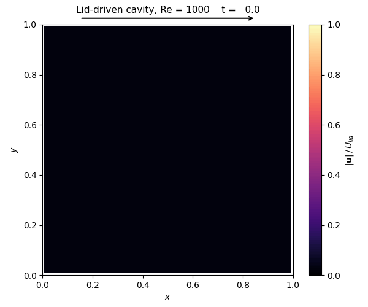
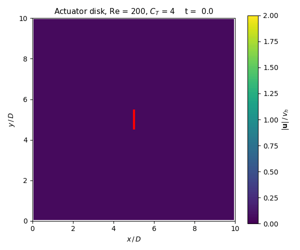
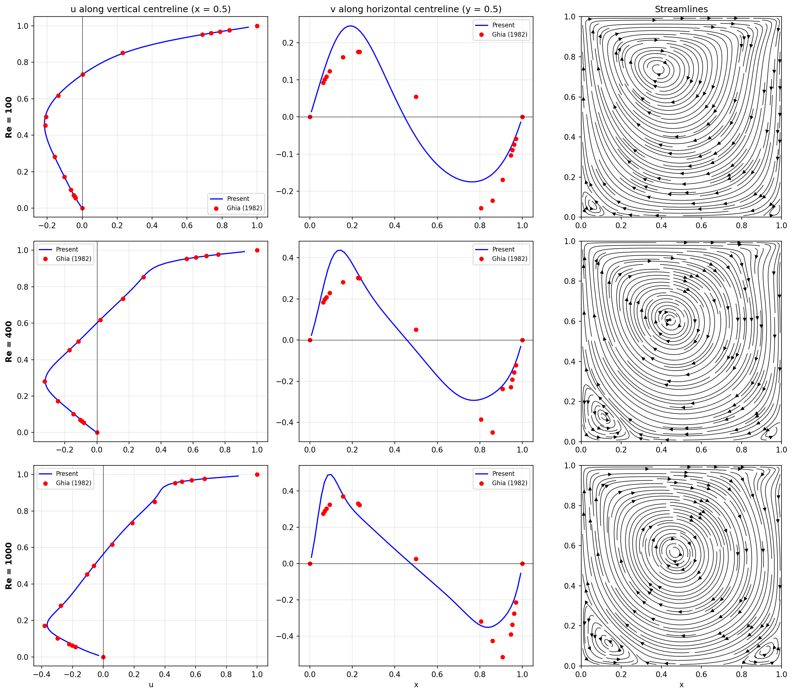

# ME 793: Computational Fluid Dynamics

Finite-difference solvers for the heat equation and the incompressible Navier–Stokes equations, written from scratch in Python (NumPy + SciPy) for ME 793 at the University of Nevada, Reno.

<table>
  <tr>
    <th width="33%">Heat equation</th>
    <th width="33%">Lid-driven cavity</th>
    <th width="33%">Actuator disk</th>
  </tr>
  <tr>
    <td></td>
    <td></td>
    <td></td>
  </tr>
  <tr>
    <td>Crank–Nicolson time marching of a 2D heat equation with a spatially varying source term</td>
    <td>Incompressible Navier–Stokes at Re = 1000 on a 65×65 staggered grid</td>
    <td>Rotor modeled as a body force; the starting vortex pair sheds and leaves a jet behind the disk</td>
  </tr>
</table>

---

## Project 1: Elliptic PDEs and the Heat Equation

Solves the steady-state and transient 2D heat equation with a spatially varying source term κ(x, y).

- Second-order central finite differences on a uniform grid, assembled as a sparse Laplacian
- Mixed boundary conditions: Dirichlet on the west and north walls, Neumann on the east and south walls
- Steady state solved directly as a Poisson problem with a hand-written conjugate-gradient solver
- Transient solution marched with Crank–Nicolson (unconditionally stable, second order in time)
- Starting from u = 0, the transient run reaches the direct Poisson solution at t* = 362.4 (relative L2 difference < 10⁻⁴)

📓 [Notebook](project_1/project_1.ipynb) · 🐍 [Solver](project_1/utils.py) · 📄 [Report](project_1/project_1_report.pdf)

## Project 2: Incompressible Navier–Stokes

A fractional-step (projection) solver on a staggered MAC grid, validated on the lid-driven cavity benchmark.

- **Predictor:** second-order Adams–Bashforth for advection and Crank–Nicolson for diffusion
- **Pressure Poisson:** `D G φ = D u* / Δt`, solved with conjugate gradient
- **Projection:** `uⁿ⁺¹ = u* − Δt G φ` makes the velocity field divergence-free
- All operators (gradient, divergence, Laplacian, advection) are **matrix-free** and passed to SciPy's CG as `LinearOperator`s. Each one is unit-tested against manufactured solutions.
- Compared against Ghia et al. (1982) at Re = 100, 400 and 1000. The vertical-centerline u-profiles agree closely, and the solver captures the primary vortex and the secondary corner vortices.

<p align="center">
  
</p>

📓 [Notebook](project_2/project_2.ipynb) · 🐍 [Operators](project_2/operators.py) · ✅ [Operator tests](project_2/operator_unit_tests.ipynb) · 📄 [Report](project_2/report/project_2_report.pdf)

## Project 3: Actuator Disk Model for UAV Wind-Sensor Placement *(in progress)*

Propeller downwash corrupts the readings of wind sensors mounted on a UAV. This project models a hovering rotor as an actuator disk (a thin band of body force in the momentum equation) and uses the Project 2 solver, unchanged, to map where the rotor disturbs the surrounding air.

- The disk force is applied in the momentum predictor, with thrust coefficient C_T = 4 (ideal Froude–Rankine hover)
- Validation against momentum theory: induced velocity v_h at the disk and 2 v_h in the far wake
- Grid-convergence study and a Reynolds-number sweep (Re = 100–1000)
- Sensor-placement maps that mark low-disturbance regions for mounting an anemometer

📓 [Notebook](project_3/project_3.ipynb) · 🐍 [Actuator disk](project_3/actuator_disk.py) · 📄 [Proposal](project_3/report/project_3_proposal.pdf)

---

## Running the code

```bash
python -m venv .venv && source .venv/bin/activate
pip install numpy scipy matplotlib jupyter
jupyter notebook
```

Open the notebooks from inside their own project folder, because they import helper modules by name. To regenerate the Project 2 and 3 animations:

```bash
python scripts/make_animations.py          # or: cavity | disk
```

## References

- U. Ghia, K. N. Ghia, and C. T. Shin, "High-Re solutions for incompressible flow using the Navier–Stokes equations and a multigrid method," *J. Comput. Phys.* 48, 387–411 (1982).
- J. B. Perot, "An analysis of the fractional step method," *J. Comput. Phys.* 108, 51–58 (1993).
